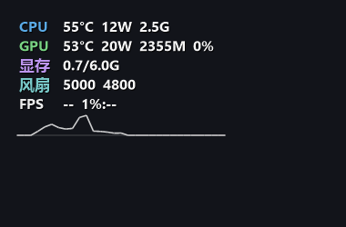

# Vitals


一个极轻量的 Windows 硬件监测工具：桌面悬浮条 + 托盘提示，实时显示 **CPU / GPU 的温度、功耗、频率、占用，显存、风扇转速、磁盘与网络速率、内存、电池，以及当前窗口的帧率**。



和 HP / OMEN / 惠普官方没有任何关系，纯第三方工具。

---

## 特点

- **单文件**：一个 exe，内嵌 PresentMon 与 MSR 模块，无 DLL、无安装程序
- **纯透明悬浮条**：只有文字、鼠标穿透，不遮挡画面；可选半透明底板
- **跟随当前窗口**：帧率跟着前台窗口走，桌面时对应当 dwm 合成器的帧率
- **每项独立开关**：CPU / GPU / 显存 / 风扇 / 磁盘 / 网络 / 电池 / 内存 / 帧率 都能单独关掉
- **自定义名称**：每类标题可改成自己的型号，支持中文
- **方案一键切换**：游戏 / 办公 / 极简，可自动按窗口切换
- **瓶颈提示**：GPU 撞功耗墙 / 温度墙时直接在读数旁标出来
- **曲线**：CPU/GPU 温度与功耗、帧率，各自可在读数下方画最近 60 个采样的折线
- **占用极低**：采样在后台线程，稳态约 0.4% 单核、48 MB 内存

---

## 系统要求

- Windows 10 / 11，64 位
- .NET Framework 4.8（Win10 1903 以上、Win11 内置）
- 管理员权限：读 CPU 温度必须提权，程序清单里已声明，双击会自动弹 UAC
- 建议放在可写的普通目录（例如 `D:\Vitals`），不要放 `C:\Program Files`

## 使用

1. **（可选但建议）** 安装 [PawnIO](https://github.com/namazso/PawnIO) 驱动 —— 用于读取 CPU 的 MSR，
   从而得到 CPU 温度、功耗、频率。不装也能用，只是 CPU 那几项显示 `--`。
2. 双击 `Vitals.exe`，UAC 点"是"。
3. 托盘出现图标，桌面左上角出现悬浮条。
4. 右键托盘 → **设置…** 配置要显示的指标、字号、背景、位置等。
5. 想开机静默启动（不再弹 UAC）：右键 → **开机自启 → 安装**。

**快捷键**：`Ctrl+Alt+M` 显示 / 隐藏悬浮条（可在设置里关闭）。

---

## 数据来源

| 指标 | 来源 |
|---|---|
| CPU 温度 / 功耗 / 频率 | PawnIO 驱动读 MSR（`0x1B1` 温度、`0x611` RAPL 能量、`0x198` 倍频） |
| CPU 占用 | `GetSystemTimes` 差值 |
| GPU 温度 / 功耗 / 频率 / 占用 / 显存 | NVIDIA NVML |
| 风扇转速 | HP BIOS 的 WMI 接口（`root\wmi` → `hpqBIntM`，命令 `0x2D`） |
| 磁盘 / 网络速率 | Windows 性能计数器（PDH，走英文计数器名，与系统语言无关） |
| 电池 | `GetSystemPowerStatus`，放电功率走 WMI `BatteryStatus` |
| 内存占用 | `GlobalMemoryStatusEx` |
| 帧率 | 内嵌 [Intel PresentMon](https://github.com/GameTechDev/PresentMon)，通过 ETW 抓取 DXGI 呈现事件 |

帧率采集**不注入游戏进程**，不会触发反作弊；1% low 取最近 2 秒内最慢 1% 帧的等效帧率。

程序只维护**一个常驻的 PresentMon 子进程**：启动前清掉上次异常退出留下的 ETW 会话和孤儿进程，
采集卡住（几秒没有新帧、事件丢失、子进程退出）会自动重启，原因写进 `Vitals.log`。

---

## 从源码构建

需要 Visual Studio 2019 / 2022（含 .NET 桌面开发工作负载），或 MSBuild + .NET Framework 4.8 目标包。

```powershell
# 1. 把 PresentMon 放到 tools/ 下（不提交进仓库，见 tools/README.md）
#    tools/PresentMon.exe

# 2. 编译
msbuild src\Vitals.csproj /p:Configuration=Release
```

产物在 `src\bin\Release\`。

缺少 `tools/PresentMon.exe` 时编译会直接报错停下 —— 少了它 exe 里就没有帧率采集能力，
不允许再打出一个帧率永远是 `--` 的包。

`src/IntelMSR.bin` 是 PawnIO 的 MSR 模块，随源码提供（见 `THIRD-PARTY-NOTICES.md`）。

### 打发布包

发布包的内容（`dist/` 里是随仓库提供的说明和脚本）：

```
Vitals.exe
使用说明.txt                                  ← dist/
关闭Vitals进程.bat                            ← dist/
清理Vitals.bat                                ← dist/
PawnIO（未安装过需先安装，安装过可删除）\
    PawnIO_setup.exe                          ← PawnIO 官方安装包，体积大，不随仓库提供
```

把它们按上面的层级放好，压成 `Vitals-v<版本>.zip` 即可发布。

---

## 已知限制

- **只支持 NVIDIA 显卡**：GPU 走 NVML，AMD / Intel 核显显示 `--`
- **风扇转速只支持惠普**：走 HP BIOS 的 WMI 接口，其它品牌读不到
- **没有显存温度**：消费级显卡基本不提供该传感器（`nvidia-smi` 里也是 N/A）
- **需要管理员**：读 MSR 的硬性要求；即使只用 GPU / 内存部分也要提权
- **帧率可能抓不到**：极少数自绘呈现引擎（部分 Vulkan / 私有管线）不会产生 DXGI 呈现事件

---

## 更新日志

- **1.0.3** —— 帧率采集改为常驻单个 PresentMon 进程；启动前清掉残留的 ETW 会话和孤儿进程，
  采集失活自动重启。修掉残留会话累积之后帧率一直显示 `--` 的问题
- **1.0.2** —— 帧率读数在采集间隙沿用上一个值，不再每 3 秒闪一下 `--`
- **1.0.1** —— 帧率采集改为短周期自终止，会话名唯一化，失败原因写进日志
- **1.0.0** —— 首个版本

---

## 许可证

[GPL-3.0](LICENSE)

本项目以 GNU General Public License v3.0 发布。你可以自由使用、修改、分发，
但分发（包括修改后的版本）时必须同样以 GPL-3.0 开源并提供完整源码，不得闭源发布。

选择 GPL-3.0 的原因：本项目的部分硬件访问方式（惠普 BIOS 的 WMI 接口）参考了
同类开源工具的既有实现，而它们多以 GPL-3 发布。采用同一许可证可以让实现方式
与社区保持一致，也避免许可冲突。

## 致谢

- [OmenSuperHub](https://github.com/breadeding/OmenSuperHub) —— 风扇转速所用的
  HP BIOS WMI 调用方式（`hpqBIntM` / 命令 `0x2D`）参考了它的实现
- [LibreHardwareMonitor](https://github.com/LibreHardwareMonitor/LibreHardwareMonitor) ——
  MSR 读取的整体思路
- [Intel PresentMon](https://github.com/GameTechDev/PresentMon) —— 帧率采集

## 第三方组件

见 [THIRD-PARTY-NOTICES.md](THIRD-PARTY-NOTICES.md)。
